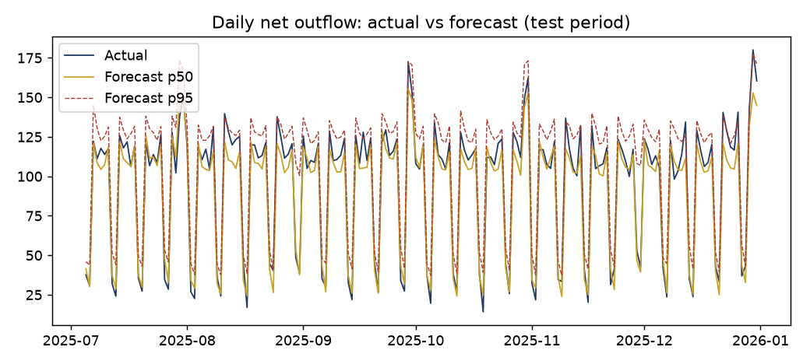
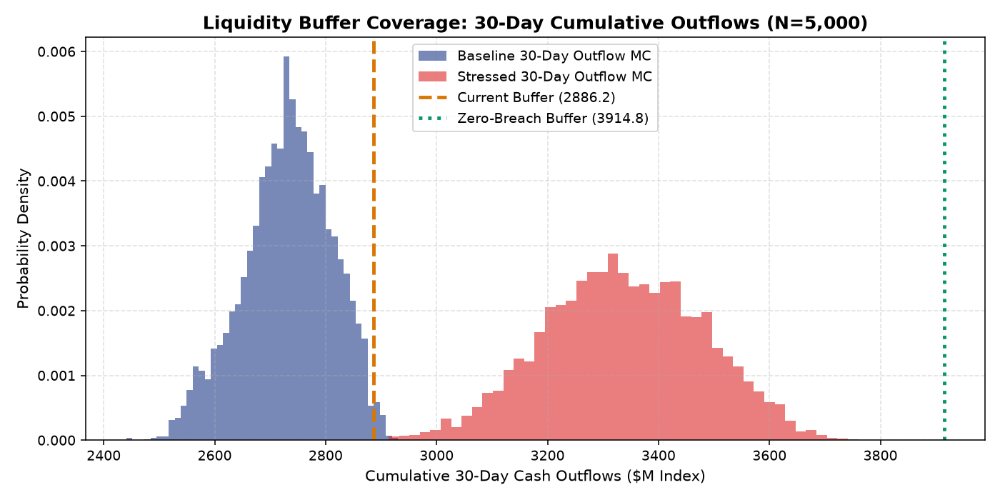

# Liquidity Stress Forecaster

*Forecast daily net cash outflow with an uncertainty band, then stress the forecast to see how long a liquidity buffer lasts.*

[](tests/)
[](run.py)
[](LICENSE)

> **Important:** All data in this repository is synthetic, generated by `src/data_pipeline.py`. Metrics show that the pipeline, econometrics, stress simulations, and financial ROI models execute end to end. Swap in real Treasury ledger data before drawing production operational conclusions.

---

## Problem & Objectives
Treasury desks need a defensible forecast of near-term cash outflows and a clear, quantitative view of liquidity buffer coverage under stress. This project builds:
1. An operational machine learning forecaster for central tendency (p50) and upper tail uncertainty (calibrated p95).
2. An econometric regression framework quantifying calendar and market stress drivers.
3. A multi-scenario stress testing suite across rolling 30-day windows.
4. A 5,000-run Monte Carlo uncertainty and reverse stress simulation engine.
5. A corporate treasury business case quantifying carry optimization savings.

---

## Verified Out-of-Sample Benchmark Results (180-Day Chronological Test)

| Model Architecture | WAPE | MAE ($M index) | RMSE ($M index) | Forecast Bias | 95% Coverage |
|---|---|---|---|---|---|
| **28-Day Rolling Mean** | 0.379 | 36.05 | 41.42 | -0.8% | N/A |
| **Seasonal Naive (Lag 7)** | 0.105 | 10.00 | 14.64 | -0.8% | N/A |
| **OLS Linear Model** | 0.087 | 8.29 | 10.43 | -3.6% | N/A |
| **Quantile Regression (p50)** | 0.083 | 7.88 | 10.11 | -2.1% | 87.8% (Uncalibrated) |
| **Gradient Boosting (p50)** | **0.073** | **6.62** | **8.85** | **-1.5%** | N/A |
| **Calibrated Upper Bound (p95)** | N/A | N/A | N/A | N/A | **94.4% (Conformal)** |

*Conformal Offset*: An out-of-fold offset of **+7.03 units** elevates empirical coverage from 87.8% to 94.4% on out-of-sample data.



---

## Stress Simulation Results (Buffer Index: 2,886.2)

| Scenario | Median Coverage | Worst Coverage | Share of Windows Breached | Minimum Survival Days |
|---|---|---|---|---|
| **Base Case (p50)** | **1.06** | 1.01 | **0.0%** | **31 Days** |
| **Mild Stress (+25% first 10d)** | **0.97** | 0.93 | **79.3%** | **29 Days** |
| **Severe Stress (p95 x1.4 first 10d)** | **0.78** | 0.75 | **100.0%** | **22 Days** |
| **Extended Stress (p95 x1.25 first 20d)**| **0.76** | 0.74 | **100.0%** | **21 Days** |
| **Persistent Elevated (+15% 30d)** | **0.92** | 0.88 | **100.0%** | **26 Days** |

*Reverse Stress Finding*: Sizing the buffer to withstand Severe Stress with zero breaches requires **3,914.8 units** (+1,028.6 shortfall). A balanced dynamic buffer target of **3,250 units** covers 90% of stress scenarios.



---

## Treasury Financial Business Case
- **Annual Benefit (Base Case)**: **$3.36M** ($2.40M buffer carry optimization + $850k avoided emergency borrowing + $112.5k labor).
- **Investment & Opex**: $260k implementation + $65k annual maintenance.
- **Financial Return**: **Year-1 Net Benefit of $3.04M**, **Payback in 0.9 Months**, and **3-Year NPV of $7.94M** (3,054% ROI).

---

## Regulatory Non-Equivalence Notice
This prototype demonstrates liquidity mechanics and scenario forecasting. It is **not** an implementation of Basel III LCR, NSFR, or FR 2052a regulatory reporting.

---

## Reproduction Commands

```bash
# 1. Setup virtual environment
python -m venv .venv
# Windows:
.venv\Scripts\activate
# Linux/Mac:
source .venv/bin/activate

# 2. Install dependencies
pip install -r requirements.txt

# 3. Execute master pipeline (data, models, regression, simulation, slides)
python run.py

# 4. Run automated test suite
python -m pytest tests/
```

---

## Author
**Bhupesh Chandra Dimri**  
Email: [bhupesh7cd@gmail.com](mailto:bhupesh7cd@gmail.com)  
GitHub: [@bhupesh-debug](https://github.com/bhupesh-debug)
